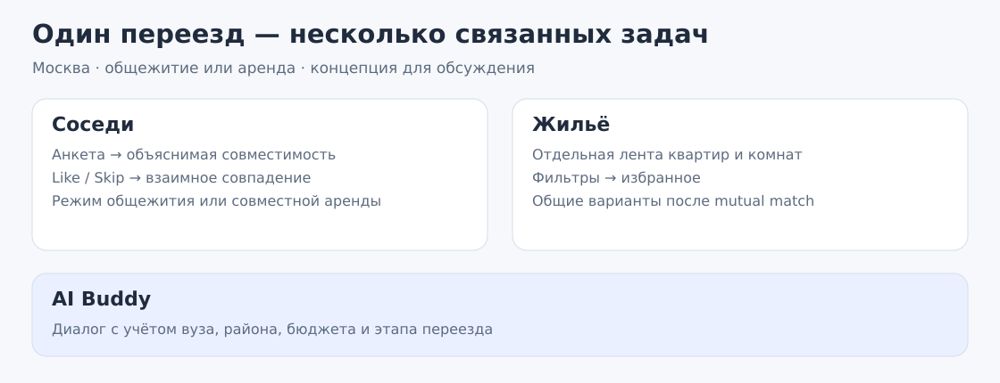

# DormBuddy

Соседи, жильё и помощь после переезда — в одном студенческом сервисе.

**Учебный проект по практикуму Python · пилот: Москва · стадия: согласование концепции**

## С чего начать

Новому участнику достаточно прочитать концепцию и границы первой версии. Остальные материалы открывай по задаче.

| Материал | Что внутри |
| --- | --- |
| [Концепция и аудитория](docs/01-concept.md) | Для кого делаем сервис и какую задачу решаем |
| [Сценарии](docs/02-scenarios.md) | Соседи, жильё, общежитие и AI Buddy |
| [Алгоритм совместимости](docs/03-matching.md) | Ограничения, score, пропуски и объяснения |
| [Границы MVP](docs/04-mvp.md) | Что берём в первую версию и что откладываем |
| [Архитектура и данные](docs/05-architecture.md) | Модули, стек, сущности и требования к качеству |
| [Работа команды](docs/06-team-work.md) | Этапы, направления работы и чек-лист согласования |
| [Демо и проверки](docs/07-demo-and-quality.md) | Что должно работать к защите |
| [Решения и вопросы](docs/08-decisions.md) | Что выбрал Михаил, что предложено и что ещё открыто |
| [Backlog](docs/09-backlog.md) | Начальный список задач с условиями готовности |
| [Истории, Story Map и CJM](docs/10-product-design.md) | Черновики для дальнейшего проектирования |
| [Контекст системы C4](docs/11-system-context.md) | Пользователь, DormBuddy и внешний LLM |
| [Материалы преподавателю](docs/12-approval.md) | Сообщение, PDF и вопросы на согласование |
| [Вложения и изображения](docs/13-materials.md) | Актуальные файлы, ранние презентации и источники |

## Что уже определено в обсуждении

- Москва — тестовый город.
- «Соседи» и «Жильё» — независимые параллельные ленты.
- Подбор для общежития — один из центральных сценариев.
- Свайпы дополняются объяснимой оценкой совместимости.
- AI Buddy — контекстный помощник по переезду и быту.
- Если подходящих API жилья нет, используем тестовую базу; интеграции и монетизацию откладываем.

Эти решения отражают позицию инициатора. Согласование команды и преподавателя ещё предстоит. Формула score, стек и распределение работы описаны как предложения.

## Для обсуждения с командой

1. Прочитайте [MVP](docs/04-mvp.md) и [открытые вопросы](docs/08-decisions.md).
2. Создайте задачу по шаблону «Вопрос или решение»; в одном обсуждении — одна тема.
3. Принятый итог внесите в журнал решений через pull request.
4. Назначьте ответственных и дедлайн до планирования первого спринта.

## Текущее состояние

Это репозиторий документации и исходных материалов. Приложение, интеграции и тесты ещё не реализованы. Персоны, требования и сценарии не заменяют исследование пользователей. Данные для демонстрации пока не подготовлены.

[Как вносить изменения](CONTRIBUTING.md) · [История изменений](CHANGELOG.md)
