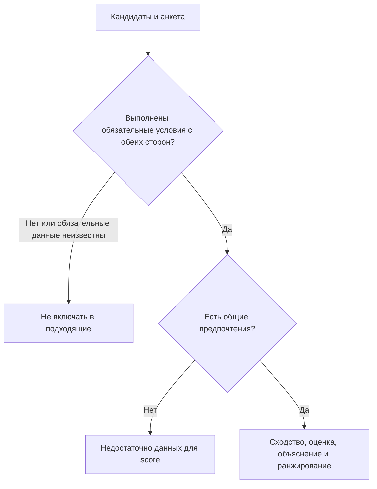

# Подбор и совместимость

[← Главная](../README.md) · Статус: предложение к согласованию

## 3. Центральная функция — объяснимый подбор соседей

Пользователь заполняет анкету. Сервис сначала проверяет обязательные условия, затем ранжирует допустимых кандидатов по бытовым предпочтениям. На карточке видны оценка совместимости и конкретные совпадения и расхождения.

### Обязательные условия

- Совместимость бюджетных диапазонов для совместной аренды.
- Вуз и общежитие, когда пользователь включил соответствующий режим и ограничение.
- Допустимость курения и проживания с животными.
- Другие условия только при явном выборе пользователя как обязательных.

Проверка двусторонняя: кандидат должен удовлетворять ограничениям пользователя, а пользователь — ограничениям кандидата. Вуз не является обязательным фильтром для всей аудитории. Бюджет означает долю расходов одного человека на жильё в месяц; дополнительные расходы показываются отдельно.

### Предпочтения

Режим сна, частота уборки, отношение к гостям, допустимый шум, готовка и общительность. Для MVP используем понятные категории и шкалы с заранее описанными правилами сравнения.

**Предлагаемый алгоритм для согласования:**

1. Исключить себя, неподходящие профили и кандидатов с конфликтом обязательных условий.
2. Для каждого заполненного с обеих сторон предпочтения вычислить сходство `s_i` от 0 до 1.
3. Рассчитать направленную оценку `S(A→B) = 100 × sum(w_Ai × s_i) / sum(w_Ai)` по сопоставимым признакам. Веса на старте равные; пользовательские веса — возможное развитие.
4. Для пары использовать среднее двух направленных оценок. Показать полноту сравнения: сколько признаков удалось сопоставить.
5. Отсортировать по оценке; при равенстве использовать стабильный порядок по идентификатору.
6. Сформировать объяснение из тех же правил: основные совпадения и существенные расхождения.

Неизвестное значение не считаем совпадением. Если неизвестен признак, необходимый для обязательного условия, профиль не попадает в подтверждённо подходящие кандидаты до заполнения. Если общих предпочтений нет, показываем «недостаточно данных», а не процент.

Оценка — индекс сходства анкет, а не вероятность успешного совместного проживания. Объяснение формируется программно; LLM не вычисляет и не меняет результат matching.

## Поток обработки

Показ score и решение о лайке — разные действия: высокий score не создаёт match автоматически.
