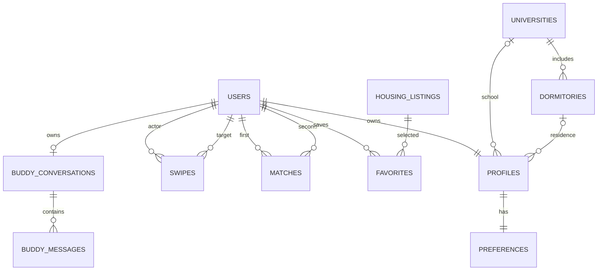

# Архитектура и данные

[← Главная](../README.md) · Реализация MVP

## 6. Архитектура и данные

Модульный монолит на Python, FastAPI, SQLAlchemy и PostgreSQL. Схему версионируем в Alembic. Интерфейс отдаётся шаблонами Jinja и использует локальные CSS, JavaScript и ассеты.

Модули: `Auth`, `Profiles`, `Matching`, `Swipes & Matches`, `Housing`, `Dormitories`, `Buddy`. Правила подбора отделяем от HTTP-обработчиков и вызовов LLM, чтобы их можно было объяснить и проверить независимо.

| Сущности | Назначение и связи |
| --- | --- |
| User, Profile, Preferences | Учётная запись и связанные с ней профиль и анкета |
| University, Dormitory | Вуз имеет несколько общежитий; профиль ссылается на выбранные записи |
| Swipe, Match | Направленное действие пользователя и уникальная неупорядоченная пара при взаимной симпатии |
| HousingListing, Favorite | Объявление и связь пользователя с избранным; пара пользователь–объявление уникальна |
| BuddyConversation, BuddyMessage | Диалог принадлежит пользователю и содержит сообщения |

Анкеты и избранное сохраняются в БД. Score на старте вычисляется по текущим данным, поэтому отдельное хранилище рекомендаций не обязательно. Изменение анкеты должно влиять на следующую выдачу.

### Схема базы

Уникальны email, направленная пара в свайпе, отсортированная пара в match, сочетание пользователя и объявления в избранном и идентификатор вопроса внутри диалога. Составной внешний ключ связывает общежитие и вуз профиля. Точная схема находится в миграции и моделях SQLAlchemy.

### Операции и доступ

| Адрес | Операция |
| --- | --- |
| `/register`, `/login`, `/logout` | Учётная запись и сессия. Вход и регистрация меняют токен CSRF |
| `/profile`, `/dormitory` | Чтение и сохранение своей анкеты, справочник вузов и общежитий |
| `/neighbors`, `/neighbors/{id}/swipe` | Выдача на текущих данных, первое действие Like или Skip |
| `/matches`, `/matches/{id}/housing` | Совпадения и пересечение избранного, доступ по участию |
| `/housing`, `/housing/{id}`, `/housing/favorites` | Независимый просмотр жилья, детали и избранное |
| `/housing/{id}/favorite` | Добавление и удаление сохранённого варианта |
| `/buddy` | Личный диалог, вопрос и повтор по идентификатору внутри диалога |

Свайпы сериализуются PostgreSQL advisory lock на двух упорядоченных ID в транзакции READ COMMITTED. Второй запрос видит уже сохранённый встречный лайк. Уникальный индекс защищает пару от дубликатов. Buddy сохраняет вопрос до вызова LLM, завершает транзакцию и записывает результат отдельной транзакцией. Состояние вопроса допускает повтор после сбоя или прерывания.

### Требования к качеству

- Пароли хранятся как стойкие хеши; API проверяет авторизацию и права доступа.
- Ключи LLM и настройки БД вынесены из репозитория и клиентского кода.
- Входные данные валидируются; ошибки имеют понятные ответы.
- Миграции и скрипт заполнения позволяют воспроизвести демонстрационную БД.
- Matching детерминирован при одинаковых данных; ошибки LLM не нарушают работу лент.
- Для обычной выдачи на демобазе предлагаем целевое время до 1 секунды на согласованной машине; вызовы LLM измеряются отдельно. Это целевой показатель, а не достигнутый результат.
