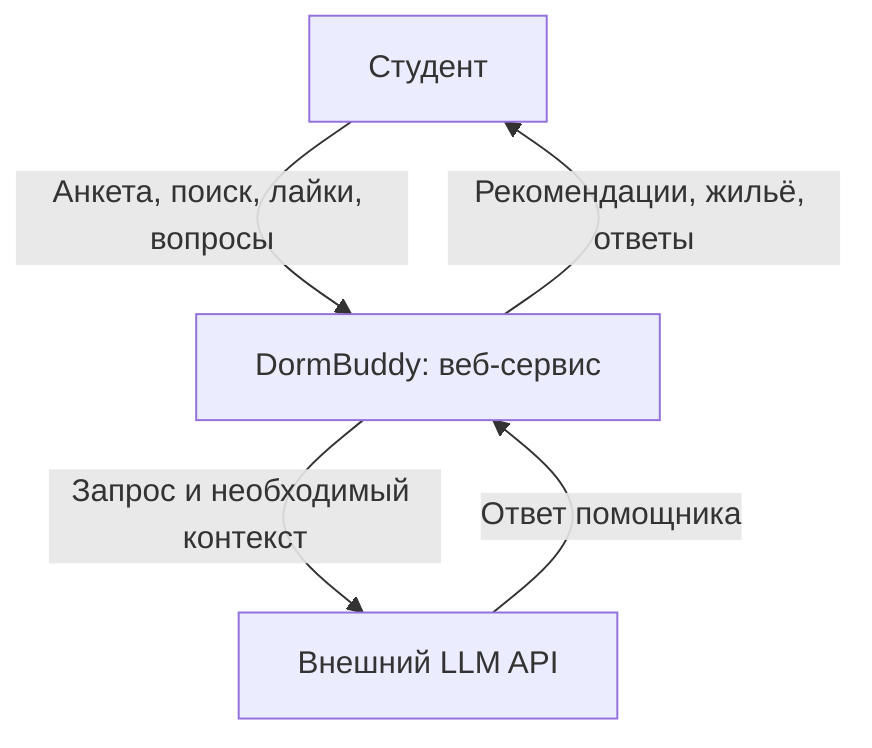
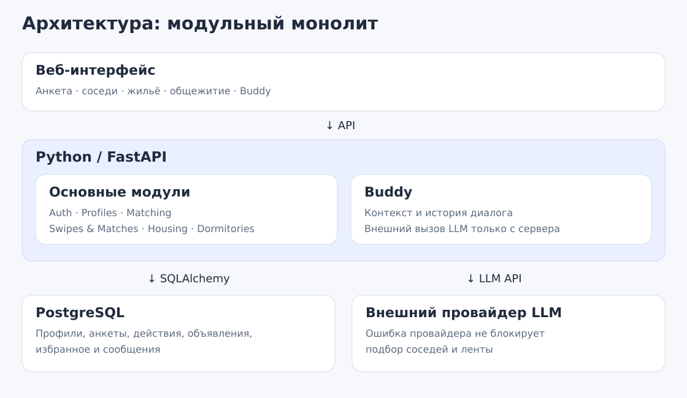

# Контекст системы C4

[← Главная](../README.md) · Проектная схема; интеграции ещё не реализованы.

На уровне контекста frontend, backend и БД входят в систему DormBuddy. Внешний API недвижимости и системы вузов не являются зависимостями MVP. Учебные объявления загружаются подготовленным набором данных.

## Внутренняя организация (дополнение к C4 Context)

Браузер обращается к FastAPI. Модули профилей, подбора, лайков, жилья и Buddy используют PostgreSQL через SQLAlchemy. Matching работает без LLM. Внешняя модель доступна через серверный модуль Buddy; ключ не передаётся в браузер.

Это модульный монолит: разделение модулей в коде не означает отдельные микросервисы. Конкретный frontend и провайдер LLM ещё не выбраны.
