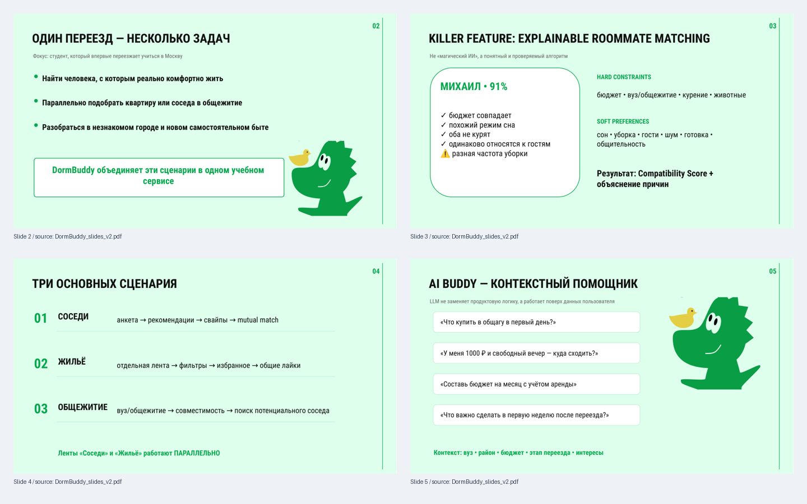

# Вложения и изображения

[← Главная](../README.md)

## Актуальные документы

- [Краткая концепция для преподавателя, 1 страница PDF](../attachments/current/DormBuddy_concept_for_approval.pdf).
- [Полная командная записка](../attachments/current/DormBuddy_team_approval.md).
- [Подробная записка преподавателю](../attachments/current/DormBuddy_Ovchinnikov_approval.md).

Рабочая документация в `docs` развивает эти записки. При последующих изменениях сначала обновляйте разделы, затем синхронизируйте вложения. Ни один файл не подтверждает уже полученное согласование.

## Ранние презентации

Это реальные страницы ранее подготовленной презентации, а не изображения работающего приложения. При расхождениях с текущей концепцией используйте документы из `docs` и журнал решений.

| Файл в репозитории | Исходное название | Статус |
| --- | --- | --- |
| [Презентация v2, PDF](../attachments/archive/DormBuddy_slides_v2.pdf) | DormBuddy_Овчинников_v2.pdf | Ранний вариант для согласования |
| [Учебная презентация, PDF](../attachments/archive/DormBuddy_educational_slides.pdf) | DormBuddy_Овчинников_учебный.pdf | Ранний вариант |
| [Редактируемая презентация, PPTX](../attachments/archive/DormBuddy_approval_slides.pptx) | DormBuddy_согласование_Овчинников.pptx | Ранний вариант |

Содержимое исходных файлов сохранено без изменений; имена упрощены для переносимых ссылок. Обещания геоданных и формулировки из ранних слайдов не расширяют MVP автоматически.

## Схемы

- [Структура продукта](../assets/diagrams/product-overview.svg): независимые ленты и общий помощник.
- [Архитектура](../assets/diagrams/architecture.svg): веб-интерфейс, монолит, БД и внешний LLM.
- [C4 Context](11-system-context.md): контекст системы в Mermaid.

Схемы созданы по текущей концепции. Это технические иллюстрации, не новая айдентика и не утверждённый дизайн интерфейса. Логотип из оригинального проекта не подменялся выдуманным знаком.

## Основание и ограничения

Решения Михаила и текущие согласовательные записки отделены от предложений реализации в [журнале](08-decisions.md). Персоны и CJM — рабочие гипотезы. Исходный лист критериев Овчинникова не найден. Сведения о сроках, составе команды, API и выбранном провайдере LLM пока отсутствуют.
